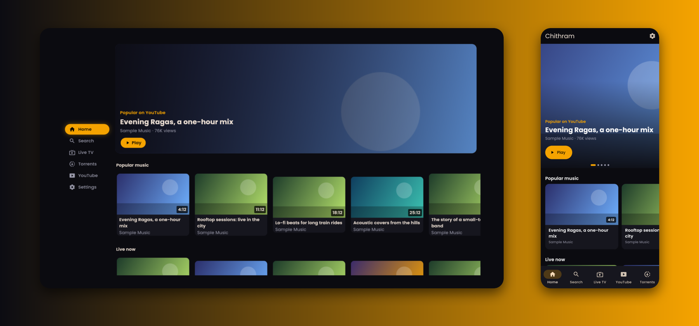
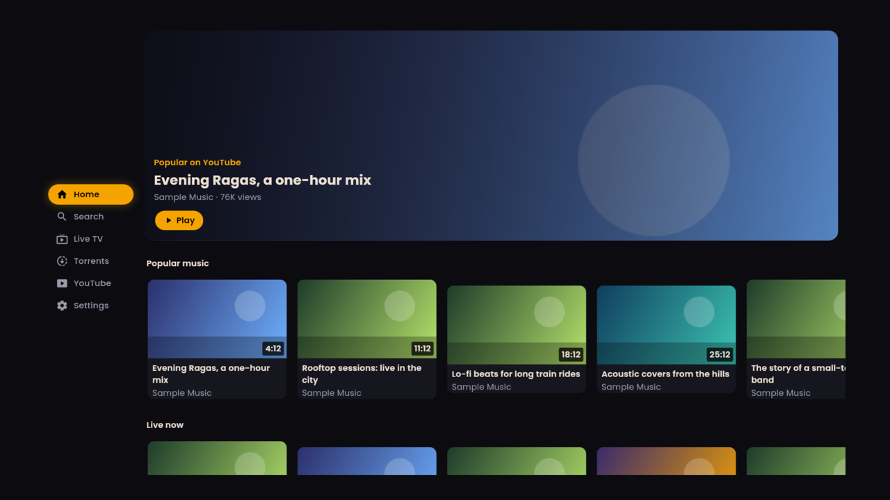
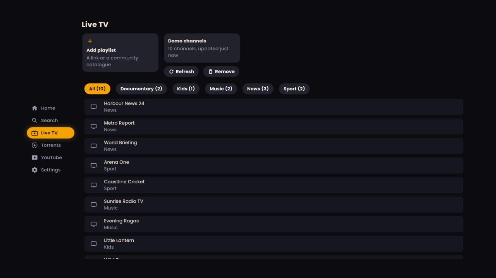
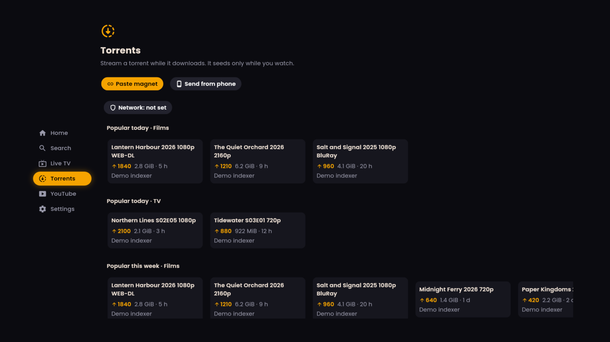
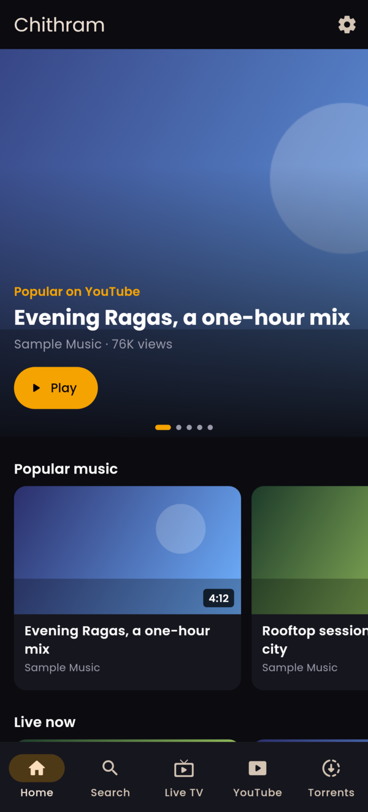
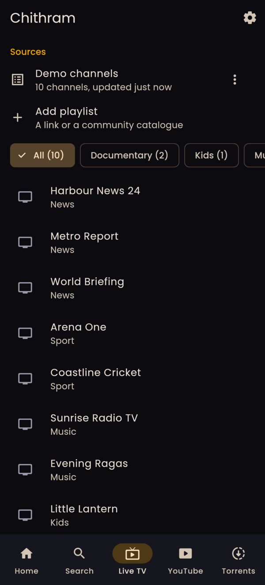
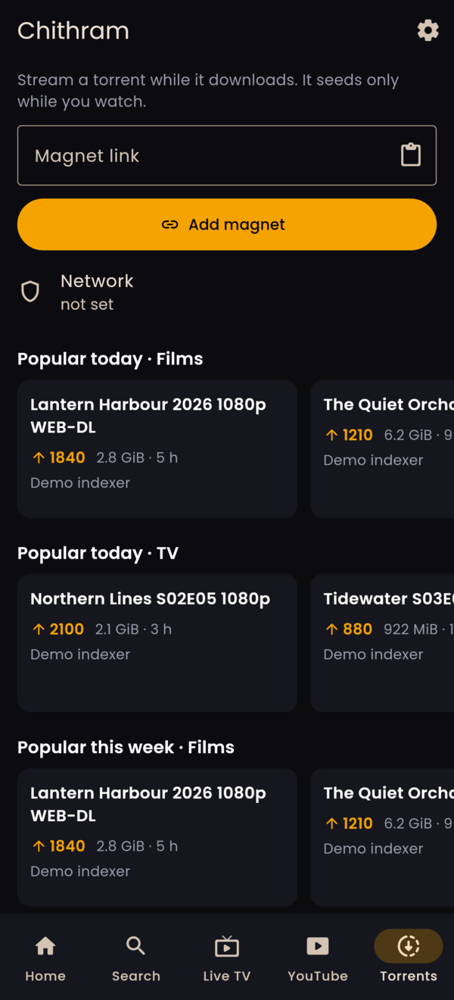
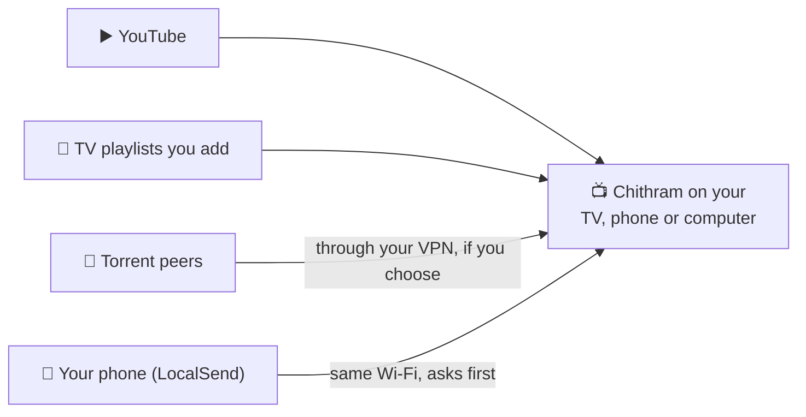

<h1 align="center">
  <br>
  <a href="https://github.com/sudharamachandranrajeev/chithram"></a>
  <br>
  Chithram
  <br>
</h1>

<h4 align="center">Watch YouTube, live TV and torrents in one ad-free app, on your TV, phone and computer.</h4>

<p align="center">
  <a href="https://github.com/sudharamachandranrajeev/chithram/releases"></a>
  
  <a href="LICENSE"></a>
</p>

<p align="center">
  <a href="#-what-it-does">What it does</a> •
  <a href="#-get-started">Get started</a> •
  <a href="#-how-it-works">How it works</a> •
  <a href="#-faq-and-troubleshooting">FAQ</a> •
  <a href="#%EF%B8%8F-for-developers">For developers</a>
</p>

<p align="center">
  
</p>

Chithram (Malayalam for "picture") is a video app for people who want to watch from many places
without ads or an account. It is built for a TV remote first, with a separate touch design for
phones. You bring your own sources: Chithram ships no channel lists, indexers or plugins. Status:
**alpha**. It works, but expect rough edges and changes between versions.

## ✨ What it does

- ▶️ **YouTube without an account** – search and play videos with no ads and no sign-in. In the
  next release, Home shows what is popular and learns what you like, on the device only.
- 📺 **Live TV** – add a TV playlist link (M3U) and flick through channels, fast even with 10,000
  of them. Dead channels are dimmed and skipped. Two free community catalogues are offered, never
  forced.
- 🧲 **Torrent streaming** – paste a magnet link, pick a file and watch while it downloads. It
  shares only while you watch, then deletes the files.
- 📲 **Send from your phone** – send a link, magnet or `.torrent` file from the LocalSend phone app
  on the same Wi-Fi. Every transfer asks first.
- ⏯️ **Pick up where you left off** – Chithram remembers your place in each video. Next release:
  audio and subtitle choice, Up Next autoplay and a seek bar with picture previews.
- 🛋️ **Made for the sofa and the pocket** – a remote-friendly TV design and a touch design for
  phones. Computers can switch to the TV look.
- 🔎 **Find torrents from your own sources** (next release) – popular lists and search from indexers
  you add (Torznab) and search plugins you install. Plugins run locked away from your files.
- ✈️ **Telegram Saved Messages** (next release) – sign in with your own account. Videos you save
  there start playing while they download.
- 🎨 **Themes** (next release) – seven dark looks, a pure black mode for OLED screens and your own
  accent colour.

## 📸 Screenshots

<table>
  <tr>
    <td align="center"><br><sub>Home on a TV</sub></td>
    <td align="center"><br><sub>Live TV on a TV</sub></td>
    <td align="center"><br><sub>Torrent Home on a TV</sub></td>
  </tr>
  <tr>
    <td align="center"><br><sub>Home on a phone</sub></td>
    <td align="center"><br><sub>Live TV on a phone</sub></td>
    <td align="center"><br><sub>Torrents on a phone</sub></td>
  </tr>
</table>

<sub>All screenshots use made-up titles, channels and torrents with generated thumbnails, rendered
from the current code. The Home and Torrent Home views arrive in the next release.</sub>

## 🚀 Get started

### Step 1 – Download

Open the [releases page](https://github.com/sudharamachandranrajeev/chithram/releases) and, under
the newest **Chithram** release, pick the file for your device:

| Your device | File to download | Works on |
| --- | --- | --- |
| 📺 Android TV box or TV, newer phones | `Chithram-<version>-android-arm64-v8a.apk` | Android 7 and newer, 64-bit |
| 📺 Older or low-cost TV boxes | `Chithram-<version>-android-armeabi-v7a.apk` | Android 7 and newer, 32-bit |
| 💻 Android emulator or x86 device | `Chithram-<version>-android-x86_64.apk` | Android 7 and newer |
| 🪟 Windows computer | `Chithram-<version>-windows-x64-setup.exe` | Windows 10 (version 1809) and 11 |
| 🐧 Linux computer | the one-command installer below, or `…-linux-x86_64.AppImage` | Arch, Omarchy, Debian 12+, Ubuntu 24.04+, Fedora (64-bit); AppImage also Ubuntu 22.04 |

Not sure which Android file? Try `arm64-v8a` first. If it will not install, use `armeabi-v7a`.
Each release also has `SHA256SUMS.txt`, a list of fingerprints to check the files are genuine.

### Step 2 – Install

<details>
<summary><b>📺 Android TV</b></summary>

1. Copy the `.apk` to the TV with a USB stick, or send it from your phone with LocalSend.
2. Open it with the TV's file manager.
3. If the TV asks, allow that file manager to install unknown apps. This is normal for apps from
   outside the TV's app store.
4. Select **Install**, then **Open**. Chithram also appears in the TV's app row.

</details>

<details>
<summary><b>🤖 Android phone</b></summary>

1. Open the downloaded `.apk` on your phone.
2. If Android asks, allow installs from your browser or file manager.
3. Tap **Install**, then **Open**.

Newer versions install over the top and keep your settings.

</details>

<details>
<summary><b>🪟 Windows</b></summary>

1. Double-click `Chithram-<version>-windows-x64-setup.exe`. No admin rights are needed.
2. Windows may say *"Windows protected your PC"*. The app is not paid-signed yet; that is the only
   reason. Click **More info → Run anyway**.
3. Follow the installer, then open **Chithram** from the Start menu.

Prefer no installer? Download `…-windows-x64-portable.zip`, unzip it anywhere and run
`chithram.exe`.

</details>

<details>
<summary><b>🐧 Linux</b></summary>

Paste this into a terminal (Arch, Omarchy, Debian, Ubuntu and Fedora, 64-bit x86):

```sh
curl -fsSL https://raw.githubusercontent.com/sudharamachandranrajeev/chithram/main/install-linux.sh | bash
```

1. It installs the video, keyring and window libraries (mpv, libsecret, GTK 3) with your package
   manager. This is the only step that asks for your password.
2. It downloads the newest release and checks it against `SHA256SUMS.txt`.
3. It installs Chithram for your user only and adds it to your app menu (on Omarchy:
   **Super + Space**).

- **Update:** run the same command again.
- **Remove:** add `-s -- --uninstall` after `bash`. Use `--no-deps` instead to skip step 1.
- **Read it first?** The script is [install-linux.sh](install-linux.sh), about 100 lines.
- **Older system?** Download the AppImage, run `chmod +x Chithram-*.AppImage`, then start it. It
  carries its own video library.

</details>

### Step 3 – First launch

There is no sign-up. Chithram opens on **Home**. Move with the remote's arrows, or tap on a phone.

1. **Watch YouTube**: open **Search** or **YouTube**, type what you want, and select a video.
2. **Add live TV**: open **Live TV → Add playlist**. Choose **Playlist URL** and paste an M3U link
   you have, or pick one of the two community catalogues. Nothing downloads until you confirm.
3. **Stream a torrent**: open **Torrents → Paste magnet** (on a phone: type it in **Magnet link**,
   then **Add magnet**). The first time, Chithram asks how to protect your connection. Pick **Use
   SOCKS5** and enter your VPN's SOCKS5 address, or **Continue without protection**.
4. **Send from your phone** (optional): on the TV, open **Torrents → Send from phone**. On a phone
   running Chithram, it is under **Settings → Receive**. Then send from the LocalSend app.

On a computer, **Settings → 10-foot TV mode** switches to the TV design.

## 🧭 How it works



- **Chithram plays the source directly.** YouTube and live TV stream straight to the player, with
  YouTube's ads left out.
- **Torrents stream as they download.** One torrent at a time. Its files are deleted when you close
  the player, so it shares only while you watch.
- **Nothing is built in.** You add every playlist, indexer and plugin. Chithram does not break copy
  protection (DRM) and does not play DRM-protected services.

## 🔒 Your data

- **No account, no cloud.** Settings, resume points and playlists stay on the device. Linux:
  `~/.local/share/dev.chithram.chithram`. Android: inside the app.
- **Next release:** your watch history and suggestions stay on the device too. **Settings → Clear
  watch history** wipes them. API keys you enter go into the system's secret store.
- **What leaves the device:** only requests to the sources you use (YouTube, your playlists, your
  indexers and torrent peers).

> [!IMPORTANT]
> Torrenting shows your IP address to every peer. Use **Use SOCKS5** with a VPN unless you are sure
> you do not need it. With SOCKS5, magnet links need trackers of their own.

## ❓ FAQ and troubleshooting

<details>
<summary><b>Does Chithram come with channels or torrents?</b></summary>

No. It ships no channel lists, indexers, plugins or add-on links. Live TV offers two public
community catalogues (iptv-org and Free-TV) as a choice. Nothing loads until you pick one.
</details>

<details>
<summary><b>Windows says the app might be unsafe</b></summary>

The build is not code-signed (a paid certificate). Click **More info → Run anyway**. Check the file
against `SHA256SUMS.txt` on the release if you want to be sure it is genuine.
</details>

<details>
<summary><b>The Android TV will not install the app</b></summary>

Allow the file manager you opened it with to install unknown apps (TV **Settings → Apps →
Security** or similar). If it still fails, your TV may be 32-bit: use the `armeabi-v7a` file.
</details>

<details>
<summary><b>A magnet link finds no peers over SOCKS5</b></summary>

With SOCKS5, Chithram turns off peer discovery that cannot go through a proxy (DHT and UDP
trackers). The magnet link needs HTTP trackers of its own. Try another link, or a `.torrent` file.
</details>

<details>
<summary><b>Search plugins say they cannot run here</b> (next release)</summary>

Plugins need Python, which Chithram brings with it. On Android it runs on 64-bit devices only for
now. Torznab indexers work everywhere.
</details>

## 🛠️ For developers

<details>
<summary>Build from source, test and release</summary>

You need [Git](https://git-scm.com) and [Flutter](https://flutter.dev) 3.47. The app and the Dart
packages form a [pub workspace](https://dart.dev/tools/pub/workspaces), so run `flutter pub get` at
the top:

```bash
git clone https://github.com/sudharamachandranrajeev/chithram
cd chithram
flutter pub get
cd app
flutter run -d linux                     # or an Android device
flutter test                             # tests
CHITHRAM_SHOTS=/tmp/shots flutter test test/screenshots_test.dart   # render TV and phone screenshots
```

- Releases are built in GitHub Actions; no local toolchain is assumed. `ci.yml` analyses and tests
  every push. `release.yml` builds signed per-ABI APKs, the Windows installer and zip, and the Linux
  AppImage and tarball, then smoke-tests them. A `v*` tag publishes a pre-release.
- Signing secrets: `CHITHRAM_KEYSTORE_BASE64`, `CHITHRAM_KEYSTORE_PASSWORD`, `CHITHRAM_KEY_ALIAS`,
  `CHITHRAM_KEY_PASSWORD`. Without them the APKs use a debug key.
- Layout: `app/` (the Flutter app, `dev.chithram.chithram`), `packages/` (`innertube` for YouTube,
  `iptv`, `localsend_rx`, `tdlib`, `torznab`, `tmdb`, `nova_host`, `torrent`, `chithram_player` and
  more), `native/torrent/` (Rust torrent engine over librqbit), `python/` (plugin sandbox).
- Changes per version: [CHANGELOG.md](CHANGELOG.md). Design: [decisions](docs/decisions.md),
  [roadmap](docs/roadmap.md), [research](docs/research.md) and [spikes](docs/spikes.md).

</details>

<details>
<summary>Credits</summary>

- [Flutter](https://flutter.dev), and [media_kit](https://pub.dev/packages/media_kit) (libmpv) for
  desktop video
- [drift](https://drift.simonbinder.eu) and [flutter_secure_storage](https://pub.dev/packages/flutter_secure_storage)
- [librqbit](https://github.com/ikatson/rqbit) for torrent streaming
- [TDLib](https://github.com/tdlib/td) for the Telegram receiver (Boost Software License)
- [LocalSend](https://localsend.org) protocol for Receive
- [SponsorBlock](https://sponsor.ajay.app) segments on the seek bar (opt-in)
- [iptv-org](https://github.com/iptv-org/iptv) and [Free-TV](https://github.com/Free-TV/IPTV) as
  opt-in playlist suggestions
- [Poppins](https://fonts.google.com/specimen/Poppins) (SIL Open Font License)
- This product uses the TMDB API but is not endorsed or certified by TMDB. See [NOTICE](NOTICE).

</details>

## Related

| App | What it does |
| --- | --- |
| [paattu](https://github.com/sudharamachandranrajeev/paattu) | A music player by the same author. Chithram's YouTube code grew from it. |
| [brahma](https://github.com/sudharamachandranrajeev/brahma) | The author's life-management suite (a separate project) |

## License

[MIT](LICENSE). Poppins is under the SIL Open Font License (`app/assets/fonts/OFL.txt`). The TMDB
logo is covered by TMDB's own terms (see [NOTICE](NOTICE)).

---

> GitHub [@sudharamachandranrajeev](https://github.com/sudharamachandranrajeev)
